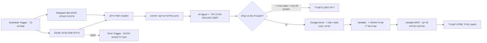

# 🧾 אוטומציה חכמה לחילוץ, פענוח ותיוק חשבוניות וקבלות (n8n + AI + Airtable MCP + Google Drive)

מערכת אוטומציה מקצה לקצה שנבנתה ב-**n8n Cloud** כדי לחסוך שעות עבודה ידניות למנהלות חשבונות ולעסקים: איסוף אוטומטי של חשבוניות וקבלות מהמייל ומטלגרם, קריאה וניתוח מבוסס בינה מלאכותית (PDF ותמונות), המרת מט"ח בזמן אמת, הזנה מסודרת ומניעת כפיליות ב-**Airtable**, תיוק היררכי ב-**Google Drive**, הפקת **דשבורד HTML** למייל והתראת תקלות מיידית לטכנאי.

---

## 🎯 הבעיה העסקית והפתרון

בעסקים רבים מנהלת החשבונות נדרשת לאסוף חשבוניות ידנית מהמייל ומקבוצות הודעות, להבחין בין חשבוניות מס וקבלות לבין הצעות מחיר או זיכויים, לתרגם חשבוניות מחו"ל, להמיר דולרים לשקלים, להקליד כל סעיף לטבלת הנהלת חשבונות ולתייק בתיקיות מסודרות בדרייב.

**האוטומציה מחליפה את כל התהליך הידני בזרימה אוטונומית שרצה כל שעתיים.**

---

## ⚙️ ארכיטקטורה וזרימת העבודה

---

## ✨ יכולות מרכזיות

* **קליטה דו-ערוצית כל שעתיים:**
  * משיכת מיילים שלא נקראו מ-**Gmail** (כולל תמונות מוטמעות ו-PDF) וסימונם כ"נקראו" רק בסיום עיבוד מוצלח.
  * משיכת תמונות ומסמכי PDF מבוט **Telegram** ייעודי (`DOSI`) תוך מעקב אחר `update_id` למניעת עיבוד חוזר.
* **ניתוח חכם מבוסס AI (טקסט + Vision):**
  * קריאת קבצי **PDF** ותמונות (**JPG / PNG**).
  * **סינון קפדני:** קולט אך ורק **חשבוניות מס** ו**קבלות** (דוחה הצעות מחיר, זיכויים, הזמנות רכש ואייקוני חתימה).
  * **תרגום אוטומטי לעברית** ותמצות תיאור הצורך עד 5 מילים.
  * **המרת מטבע בזמן אמת:** כלי HTTP Tool מובנה מושך שער דולר-שקל עדכני וממיר סכומים ומע"מ לשקלים חדשים (`ILS`).
* **אינטגרציה מתקדמת עם Airtable + Airtable MCP:**
  * פירוט כל פעולה מתומחרת בחשבונית בשורה נפרדת, ולאחריה שורת **`סה"כ`** מסכמת תחת הנושא הכללי של השירות.
  * בדיקה מונעת כפיליות לפני הזנה + סריקה יזומה ומחיקת כפיליות באמצעות **Airtable MCP** (תוך שמירת הרשומה המקורית הראשונה).
* **קטלוג היררכי אוטומטי ב-Google Drive:**
  * בנייה אוטומטית של עץ התיקיות: `חשבוניות וקבלות / <נושא> / <שנה> / <חודש>`.
  * שמירת הקבצים לפי פורמט שם הפריט והיום בחודש (למשל: `מכונת כביסה .23.`).
* **דשבורד HTML מעוצב במייל:**
  * שליחת דו"ח RTL מעוצב בסיום כל ריצה עם פילוח מקורות, סכומים מצטברים מ-Airtable, כמות כפיליות שטופלו ומסמכים שסוננו.
* **ניטור והתראות לטכנאי:**
  * שימוש ב-`Error Trigger` ששולח מייל בעברית ברורה עם שם הרכיב שכשל, פרטי השגיאה וקישור ישיר להרצה ב-n8n.

---

## 📁 קבצים במאגר

| קובץ | תיאור |
|---|---|
| `workflow.json` | ייצוא מלא של הוורקפלוו מ-n8n (נקי ממפתחות ומזהים חסויים, מוכן לייבוא) |
| `README.md` | תיעוד מלא של הארכיטקטורה, היכולות והוראות ההתקנה |

---

## 🚀 איך לייבא ולהפעיל

1. פתחו את סביבת **n8n** ובחרו ב-**Import from File** על הקובץ `workflow.json`.
2. חברו את ה-Credentials שלכם בנודים הרלוונטיים:
   * **Gmail** (`gmailOAuth2`)
   * **Telegram** (`telegramApi`) — ועדכנו את טוקן הבוט בשדה ה-URL של `Get Telegram Updates`
   * **Google Drive** (`googleDriveOAuth2Api`)
   * **Airtable** (`airtableOAuth2Api`) + **Airtable MCP** (`airtableMcpOAuth2Api`)
   * **OpenAI** (`openAiApi`)
3. עדכנו את כתובת המייל של מנהלת החשבונות / הטכנאי בנודים `Send Dashboard Email` ו-`Alert Technician (Gmail)`.
4. הריצו בדיקה ידנית (`Execute`) ולאחר האימות הפעילו עם **Publish**.
